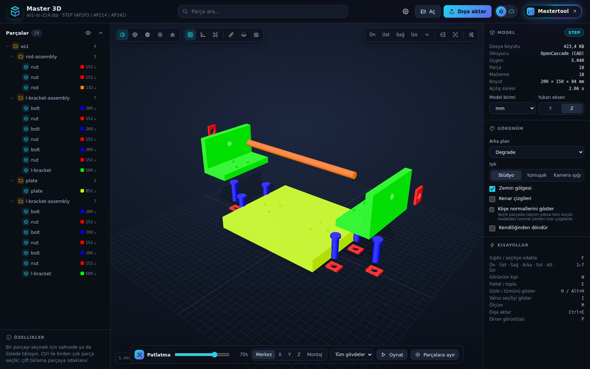

# Master 3D

3B dosyaları açan, inceleyen, **parçalarına ayıran (patlatma)** ve başka 3B biçimlere **dışa aktaran** Windows masaüstü
uygulaması. glTF, FBX, OBJ, STL, STEP, IGES, 3MF, IFC, USDZ, Rhino 3DM, Blender ve 40'tan fazla biçimi ek program kurmadan açar;
GLB, FBX, OBJ, STEP, STL, 3MF, USDZ ve 15 biçime yazar. Dosyalar yalnız bu bilgisayarda işlenir.

Mastertool ailesinin **Araçlar** grubundandır (uygulama kodu `m3`). Kendi sitesi yoktur: tanıtım
[mastertool.download/araclar/master-3d](https://mastertool.download/araclar/master-3d), indirme Mastertool **Hesabım** sayfasından
ve **Master Tool** masaüstü uygulamasından.



## İndirme

- `Master-3D-Setup-x.y.z.exe`: kurulum (`Program Files\Mastertool\Master 3D`, Başlat menüsünde Master Tool › Master 3D).
- `Master-3D-Portable-x.y.z.exe`: kurulumsuz, tek dosya.

## Özellikler

- **Açılan biçimler** (her biri gerçek örnek dosyayla doğrulanır — [docs/format-verification.md](docs/format-verification.md)):
  glTF / GLB (Draco, KTX2, meshopt), FBX, OBJ + MTL, COLLADA, USD / USDA / USDC / USDZ, 3DS, Blender (2.4–2.7x), DirectX X ·
  STEP, IGES, BREP (OpenCascade), Rhino 3DM, IFC (web-ifc), DXF · STL, 3MF, AMF, G-code, OFF · PLY, PCD, XYZ, VTK / VTP, PDB ·
  VRML, X3D, LWO, VOX, KMZ, MD2, MD5, MS3D, B3D, AC3D, ASE, COB, NFF, OpenGEX, Quick3D, SMD, XGL, BVH · ZIP (model + dokular).
- **Görüntüleme**: döndür / kaydır / imlece yakınlaştır, hazır görünümler, perspektif / ortografik; gölgeli, kenarlı, tel kafes,
  X-ışını, normaller; stüdyo ışığı ve zemin gölgesi; ızgara, eksenler, sınır kutusu ve ölçüler; iki nokta arası ölçüm; kesit
  düzlemi; animasyon oynatma; 2× PNG ekran görüntüsü.
- **Parça ağacı ve özellikler**: dosyanın hiyerarşisi (STEP montajı, IFC katları, glTF düğümleri), arama, gizle / göster / yalnız
  bunu göster; üçgen, boyut, yüzey alanı, hacim, malzemeler.
- **Patlatma**: ortadan dışa, X / Y / Z boyunca ya da montaj ağacına göre; parça düzeyi; canlandırma. Montaj bilgisi olmayan
  dosyalarda **bağlantısız parçalara ayırma**.
- **Dışa aktarma**: GLB, glTF, FBX 7.4, OBJ + MTL, COLLADA, USDZ, STEP AP214, STL (ikili / ASCII), 3MF, PLY (ikili / ASCII),
  VRML, X3D, OFF — tüm model, seçili parçalar ya da görünenler; her parça ayrı dosya; birim ve eksen dönüşümü
  ([docs/export-verification.md](docs/export-verification.md)). STEP'te **düzlemsel yüz birleştirme** (ayarlanabilir yüzde):
  düz yüzeyler CAD'de üçgen üçgen değil tek yüz olarak açılır.
- **Gezgin**: "Master 3D ile aç" sağ tık menüsü ve "Birlikte aç" listesi (varsayılan uygulama değişmez), sürükle-bırak, son
  açılanlar, tek pencere.
- **Mastertool hesabı**: ortak oturum (SSO) ve uçtan uca şifreli ayar senkronu; 8 dil, Gece / Gündüz / Sistem teması.

Ayrıntılar, teknoloji ve bilinen sınırlar: [docs/site-teknik.md](docs/site-teknik.md).

## Geliştirme

```bash
npm install
npm start                          # scripts/build.js (esbuild + WASM kitaplıkları) && electron .
npm start -- --open C:\yol\parca.step
npm test                           # node --test (54 test)
npm run samples                    # gerçek örnek dosyalar → samples/ (git'e girmez)
npm run verify-formats             # örnekleri arayüzde açar → docs/format-verification.md (Chromium: CHROMIUM_PATH)
npm run verify-export              # her biçime yazar ve geri açar → docs/export-verification.md
npm run screenshots                # docs/screenshots (tr) ve docs/screenshots/en
npm run e2e -- samples/step/as1-oc-214.stp   # gerçek Electron: giriş, açma, CSP (Linux'ta DISPLAY gerekir)
npm run icon                       # build/icon.svg → icon.png + icon.ico
npm run dist                       # Windows: kurulum + portable (dist/)
```

Kod düzeni: `src/main.js` (ana süreç), `src/protocol.js` (m3:// protokolü), `src/formats.js` (biçim kaydı), `src/core/`
(okuma, sahne, patlatma, dışa aktarma — Node'da test edilir), `src/renderer/app/` (pencere; `src/renderer/gen/` derleme çıktısı).
Sunucu adresi `M3_API` ortam değişkeniyle değiştirilebilir (varsayılan `https://mastertool.download`).

## Yayın

`v1.2.3` gibi bir etiket gönderilince GitHub Actions derler, Release'e ekler ve mastertool.download'a yükler (secret
`MASTER_RELEASE_KEY`). Ayrıntı: [docs/site-teknik.md › Sürüm yayını](docs/site-teknik.md#sürüm-yayını).

## Lisans

MIT. Kullanılan açık kaynak bileşenler ve lisansları: Ayarlar › Hakkında (three.js MIT, OpenCascade LGPL-2.1, assimp BSD-3,
web-ifc MPL-2.0, rhino3dm MIT, Draco / Basis Universal Apache-2.0, fflate MIT). WebAssembly kitaplıkları uygulamadan ayrı
dosyalar olarak dağıtılır ve lisans metinleri `src/renderer/gen/vendor/licenses/` altındadır.
